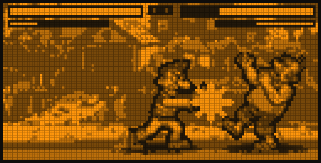
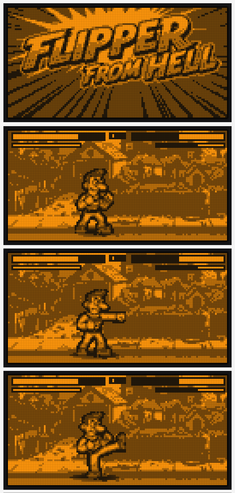

# Flipper from Hell

**Real grayscale on a 1-bit screen.**

The Flipper Zero's display only knows black and white. This 2D fighting game shows smooth shades of gray anyway – by flickering every pixel faster than the LCD can follow.

  
  &nbsp;
  

No Flipper needed for the browser demo.

## How the gray works

- Every frame is split into several **sub-frames**. A pixel that is on in 1 of 4 sub-frames looks dark gray, in 3 of 4 light gray.
- The sub-frames run faster than the LCD can follow, so your eye blends them into **real gray** – no checkerboard patterns, no spatial dithering.
- **GRAYSCALE** in Settings sets the depth from s3 to s8: more steps give smoother grays at a slightly lower frame rate (s4 is the default).
- The street in the background stays in mid and dark grays, so the fighters stand out. The HUD is pure black and white.

The grayscale core is based on the freely reusable technique from `docs/grayscale.md` of [flipper-doom](https://github.com/HedgDifuse/flipper-doom) (CC0).

## The game

Two hand-drawn fighters on a scrolling suburban street, in the style of classic arcade brawlers. Full sprite sets (walk, jump, crouch, punch, kick, block, special, K.O. …), best of three rounds, 100 HP and 60 seconds per round. A special bar fires a ranged projectile you can jump or duck. Sound effects and a looping smooth-jazz melody share the piezo speaker.

## Install

1. Download the `.fap` for your firmware (official or Momentum) from **[Releases](../../releases)**.
2. Copy it to your Flipper's SD card into `apps/Games/` (qFlipper or the Flipper mobile app).
3. Start it under **Apps → Games → F-FromHell**.

When official or Momentum releases a new firmware, the `.fap` files are rebuilt automatically within a day.

## Build it yourself

In a terminal inside this folder (Flipper connected via USB, qFlipper closed):

    python3 -m ufbt launch

## Controls

| Button | Action |
|---|---|
| Left / Right | Move |
| Up | Jump |
| Down (hold) | Crouch |
| Back (tap) | Attack: Forward + Back = kick, Down + Back = low kick, in the air = jump kick, otherwise punch |
| OK | Special attack (when the bar is full) |
| Back (hold) | Quit |

Hold away from the opponent to **block**. **Jump or duck** to dodge the special projectile.

**Title screen:** Up / Down picks **START** or **INFO** (help pages), OK confirms.
**Hold OK** (title screen or mid-fight) opens **Settings**: SOUND and MUSIC volume (0–10), GRAYSCALE depth (s3–s8).

## Credits & license

Character art by the original character designer of the *Neighbours from Hell* games.

GPL-2.0-or-later. Grayscale core based on [flipper-doom](https://github.com/HedgDifuse/flipper-doom) `docs/grayscale.md` (CC0).
