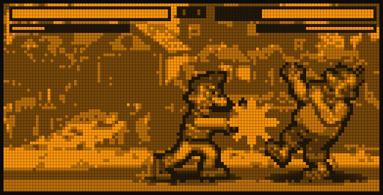
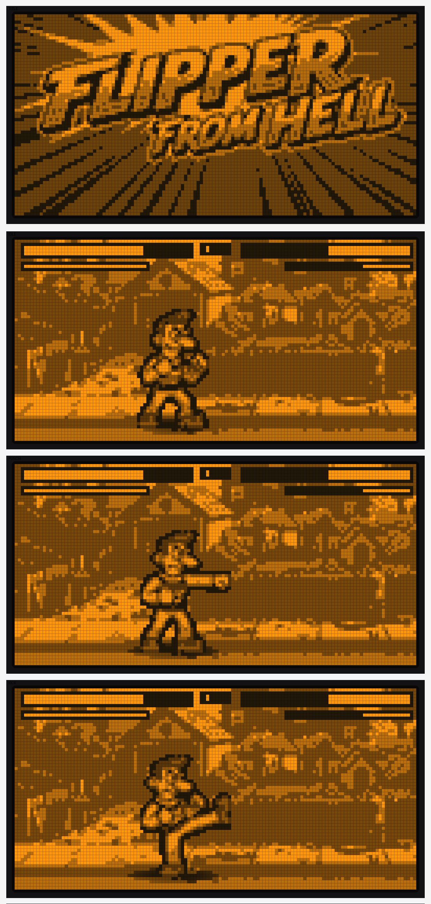

# Flipper from Hell

  

A 2D fighting game for the Flipper Zero in the style of classic arcade
brawlers, rendered in real grayscale on the 1‑bit display. Shades are
produced by temporal dithering — lighting each pixel in a fraction of
several sub‑frames shown faster than the LCD can follow, so the eye blends
them into gray. Tested on Momentum firmware.

Two hand‑drawn fighters battle across a detailed, scrolling suburban street.
Each fighter is a full sprite set (idle, walk, jump, crouch, punch, kick, low
kick, jump kick, block, hit, special, K.O. and victory). Matches are best of
three rounds.

Character art by the original character designer of the *Neighbours from
Hell* games.

## Build & run

In a terminal inside this folder (Flipper connected via USB, qFlipper
closed):

    python3 -m ufbt launch

The app then appears on the Flipper under **Apps → Games → F-FromHell**.

## Controls

| Button | Action |
|---|---|
| Left / Right | Move (toward the opponent counts as "forward") |
| Up | Jump |
| Down (hold) | Crouch |
| Back (tap) | Attack — Forward + Back = kick, Down + Back = low kick, in the air = jump kick, otherwise = punch |
| OK | Special attack (when the special bar is full) |
| Back (hold) | Quit |

Hold away from the opponent (while standing) to **block**, which greatly
reduces incoming damage. **Jump or duck** to dodge the opponent's special
projectile.

## Start screen & menus

The game opens on a title screen:

| Input | Action |
|---|---|
| Up / Down | Select **START** or **INFO** |
| OK | Confirm (START begins the match, INFO opens the help pages) |
| OK (hold) | Open the **Settings** menu |

**INFO** shows the controls across several pages using on‑screen Flipper
button icons; Left / Right turns the page, Back returns to the title.

After START, a short **"VS" intro** plays, then the first round begins. When
a match ends, press OK (or wait) to return to the title.

## Settings (hold OK)

| Row | Adjust with Left / Right |
|---|---|
| SOUND | Sound‑effect volume (0–10) |
| MUSIC | Music volume (0–10) |
| GRAYSCALE | Shading depth s3–s8 — more steps give smoother grays at a slightly lower frame rate (s4 default) |

Settings can be opened from the title screen or mid‑fight. Back closes it.

## The match

- 100 HP per fighter and 60 seconds per round.
- Reduce the opponent's HP to zero to win the round; on timeout the higher HP
  wins. Two round wins take the match (best of three).
- The **special bar** charges as you deal and take damage. When full, OK
  fires a **ranged special projectile** that can be jumped or ducked.
- On a K.O. the loser topples backward and lands on the ground while the
  winner repeatedly throws their arms into the air.
- "YOU WIN" / "YOU LOSE" and every call‑out (ROUND 1 / FIGHT / K.O.) are
  shown in bold white letters with a black outline.

## Audio

- **Sound:** hit and action effects (volume adjustable in Settings).
- **Music:** a looping, original background melody — a laid‑back smooth‑jazz
  loop. Sound and music share the single piezo speaker; a hit briefly takes
  priority over the music.

## Graphics

- Fighters are stored and drawn at native resolution with a one‑pixel black
  outline, a soft ground shadow, a two‑pose walk cycle with a slight bob, and
  idle breathing.
- The scrolling street background is held to mid and dark grays (no pure
  black) so the fighters stand out clearly in front of it. The camera follows
  the player, so the background scrolls only when the player moves.
- Everything renders in grayscale without spatial dithering; the HUD is pure
  black and white, with the health and special bars reading full = white and
  draining toward black as damage is taken.

## License

GPL-2.0-or-later. The grayscale core is based on the freely reusable
technique from `docs/grayscale.md` of
github.com/HedgDifuse/flipper-doom (CC0).
